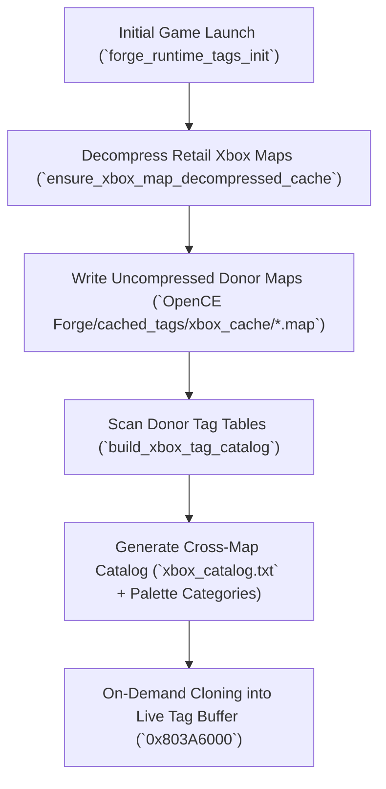
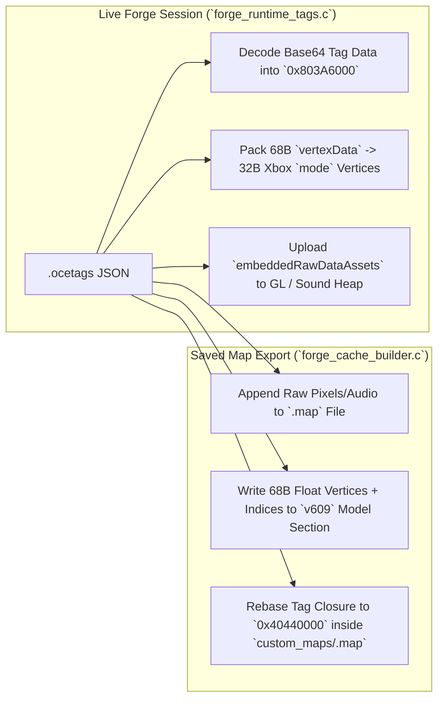

# OpenCE & Forge Tag Cache Technical Brief

This document explains how the built-in **OpenCE** cache system operates, how **OpenCE Forge** builds its cross-map tag cache on initial launch, how custom `.ocetags` packages are injected into live memory and baked into standalone `.map` files, how the Forge mode features are implemented without modifying upstream OpenCE sources, and the technical bugs encountered and resolved during development.

---

## 1. How the Built-in OpenCE Cache System Works

Halo: Combat Evolved does not load loose `.tag` files at runtime. Instead, each level is pre-compiled into a monolithic **`.map` cache file** containing a fixed-base-address memory image of every tag (`scnr`, `sbsp`, `vehi`, `weap`, `scen`, `mod2`/`mode`, `coll`, `bitm`, `snd!`, etc.) along with raw vertex, index, bitmap, and sound buffers.

OpenCE (`cachebeta.exe` decompilation + platform layer) supports two distinct `.map` architectures simultaneously:

### A. Retail Xbox Cache Files (`version = 5`, Base Address `0x803A6000`)
* **Implementation:** [`source/cache/cache_files.c`](source/cache/cache_files.c) and [`source/cache/pc_tag_cache.c`](source/cache/pc_tag_cache.c).
* **Compression & Scratch Staging:** Retail Xbox `.map` files (`a10.map` through `d40.map`, `ui.map`, and multiplayer maps) are compressed after their 2048-byte header. When a map loads, [`cache_file_precache()`](source/cache/cache_files.c) decompresses the map into a rotating scratch cache (`z:\cache000.map` .. `cache005.map`).
* **Fixed Memory Mapping (`0x803A6000`):** The engine maps the tag data buffer directly to virtual address `0x803A6000` (`TAG_DATA_LOAD_ADDRESS`). Because the cache was pre-linked for `0x803A6000`, all internal tag block pointers (`struct tag_block.address`), tag reference name pointers, and BSP pointers are already valid virtual memory addresses as soon as the block is read into `0x803A6000`.
* **Xbox Model Geometry (`mode`):** Uses 104-byte geometry parts (`c_model_geometry_part`) with **32-byte compressed vertices** (`normal`, `binormal`, `tangent` packed as 11-11-10 bit vectors; `uv` as 16-bit signed shorts; `node0`/`node1` indices and a 16-bit weight) stored inside a shared vertex/index cache section immediately preceding the tag data.
* **Validation:** Before any tag is touched by the engine, [`tag_cache_prevalidate()`](port/linux/game/tag_validate.c) walks every tag group's schema ([`tag_schema_generated.c`](port/linux/game/tag_schema_generated.c)) to bounds-check every `tag_block`, `tag_reference`, and `tag_data` offset against the `23 MiB` tag buffer (`TAG_DATA_STORAGE_SIZE`).

### B. Halo PC / Custom Edition Cache Files (`version = 7` / `609`, Base Address `0x40440000`)
* **Implementation:** [`port/linux/game/custom_edition_cache.c`](port/linux/game/custom_edition_cache.c), [`port/linux/game/cache_file_formats.c`](port/linux/game/cache_file_formats.c), and [`port/linux/game/custom_edition_geometry.c`](port/linux/game/custom_edition_geometry.c).
* **Address Rebasing (`0x40440000` -> `0x803A6000`):** PC/Custom Edition maps are linked for base address `0x40440000` (with BSP headers after the tag buffer instead of inside the scenario). When OpenCE loads a `custom_maps\<name>.map`, [`custom_edition_load_map()`](port/linux/game/custom_edition_cache.c) translates all `0x40440000`-based pointers to `0x803A6000` and converts PC tag layouts into Xbox tag layouts in-place.
* **External Resource Maps (`bitmaps.map`, `sounds.map`, `loc.map`):** Unlike Xbox maps (which embed all pixels and audio), Custom Edition maps can mark a tag instance with `flags & 1` (external resource index) or store external file offsets in `bitm`/`snd!` pixel/sample fields that read from shared `custom_maps/bitmaps.map`, `sounds.map`, and `loc.map`.
* **PC Model Geometry (`mod2` -> `mode`):** PC maps use `mod2` (GBXModel) with **132-byte geometry parts** and **68-byte uncompressed floats** in the map's raw model vertex/index buffers. [`custom_edition_geometry.c`](port/linux/game/custom_edition_geometry.c) converts the 132-byte `mod2` parts into 104-byte Xbox `mode` parts, packs the 68-byte uncompressed float vertices into 32-byte Xbox compressed vertices (and keeps the float vertices in a companion cache for the GL renderer), and updates `local_node_indices` so bone transforms animate properly.

---

## 2. How Forge Builds Its Tag Cache on Initial Launch

In stock Halo, a multiplayer map like `bloodgulch.map` only contains the tags that Bungie placed on Blood Gulch. You cannot spawn a Covenant Dropship, Pelican, Wraith, Shade Turret, Campaign Flood/Covenant biped, or Halo trees/doors unless their entire dependency tree exists inside `0x803A6000` during the match.

To make **every object across all Campaign and Multiplayer maps** available in Forge on any map, [`FORGE CODE/src/forge_runtime_tags.c`](FORGE%20CODE/src/forge_runtime_tags.c) builds a persistent local donor cache on initial launch:

### Step 1: Decompressing Retail Xbox Maps (`ensure_xbox_map_decompressed_cache`)
* On the first launch of `HaloCE Forge.exe`, Forge scans `assets/maps/*.map` (`a10`, `a30`, `a50`, `b30`, `b40`, `c10`, `c20`, `c40`, `d20`, `d40`, and all MP maps).
* Any compressed Xbox `version = 5` map is decompressed once and written to `OpenCE Forge/cached_tags/xbox_cache/<map>.map`. Subsequent launches see the cached uncompressed `.map` files and start instantaneously.

### Step 2: Building the Cross-Map Tag Catalog (`build_xbox_tag_catalog`)
* Forge reads the tag header at `header.tag_data_offset` in every cached Xbox map (`base = 0x803A6000`) and indexes every spawnable tag (`scen`, `vehi`, `weap`, `eqip`, `bipd`, `garb`, `mach`, `ctrl`, `lifi`, `ssce`, `effe`, `proj`, ` ligh`) into `OpenCE Forge/cached_tags/xbox_catalog.txt`.
* It also generates `.ftag` marker stubs in `OpenCE Forge/cached_tags/` for:
  * All discovered Xbox tags (`xbox_<group>_<path>.ftag`)
  * Custom Forge synthetic markers (`Forge/Markers/Spawn Point`, `CTF Flag`, `KOTH Hill Marker`, `Oddball Spawn`, `Race Checkpoint`, `Teleporter Enter/Exit`, `Doors`, and `Blue/Red Beam Emitters`).

### Step 3: On-Demand Deep Tag Cloning into `0x803A6000` (`load_native_xbox_tag_from_decompressed_map`)
* When you select an item in the Forge palette that is not yet in the current map:
  1. Forge locates the donor `.map` in `xbox_cache/` where that tag lives.
  2. Using OpenCE's exact tag validation schemas (`tag_schema_for_group`), [`clone_donor_tag_recursive()`](FORGE%20CODE/src/forge_runtime_tags.c) walks the root tag and **every child `tag_block`, `tag_reference`, and `tag_data`** recursively.
  3. For every `mode` (model), it extracts the raw 32-byte compressed vertices and 16-bit triangle indices from the donor map's vertex/index buffers and appends them to the current map's live vertex/index buffers, updating `vertex_offset` and `index_offset`.
  4. For every `bitm` (bitmap) and `snd!` (sound), it copies the raw Xbox swizzled/DXT textures and ADPCM audio frames into heap/raw storage and updates the descriptor offsets.
  5. Finally, [`append_runtime_tag_instance()`](FORGE%20CODE/src/forge_runtime_tags.c) expands the live tag array at `0x803A6000`, registers the new `tag_index`, and calls `custom_edition_PostprocessTagInstance` so the engine can immediately spawn it via `object_new()`.

---

## 3. How the Injected `.ocetags` System Works (Live & Baked)

The **`.ocetags`** format (`formatVersion: 5`) is a self-contained JSON + Base64 tag bundle located in `OpenCE Forge/Tags/*.ocetags` (e.g., `flyable_pelican.ocetags`, `Wraith.ocetags`). It packages a complete Custom Edition (`v609`) tag closure extracted from a custom map so users can drop custom vehicles, weapons, or scenery into Forge with zero map-editing tools.

### Structure of an `.ocetags` Package
1. **`tags[]` Array:** Every tag in the dependency closure (`vehi`, `mod2`, `coll`, `antr`, `phys`, `weap`, `proj`, `effe`, `bitm`, `snd!`, etc.) with:
   * `"group"`, `"path"`, `"sourceIndex"`
   * `"data"`: Base64-encoded raw tag memory rebased to offset `0` (already converted to Xbox struct sizes where applicable, except `mod2` parts which include both raw data and explicit JSON geometry).
   * `"gbxmodelGeometryParts[]"`: Explicit JSON arrays for each `mod2` geometry part containing `"vertexData"` (Base64-encoded 68-byte uncompressed PC float vertices) and `"triangleData"` (Base64-encoded 16-bit triangle strip indices).
2. **`embeddedRawDataAssets[]` & `embeddedRawDataPatches[]`:** Base64-encoded raw pixel data (for custom bitmaps) and sound samples (for custom audio), plus the exact byte offset inside each `bitm` or `snd!` tag where the file offset needs to be patched.

### Dual-Path Execution: Live Injection vs. Saved Map Baking

#### Path A: Live Injection in Forge (`load_native_ocetags_package_from_json` in [`forge_runtime_tags.c`](FORGE%20CODE/src/forge_runtime_tags.c))
When you select an `.ocetags` item in Forge to preview or place it:
1. Forge parses the `.ocetags` JSON in-memory and allocates space in the live `0x803A6000` tag buffer for every tag in `tags[]` that isn't already loaded.
2. It rebases all internal `0x803A6000` pointers in each tag's Base64 `"data"` block to the newly allocated address inside `0x803A6000`, and resolves all cross-tag references (`0xE744xxxx`) to the new runtime `tag_index` handles.
3. For `mod2` tags, it converts the group to `mode`, reads `"gbxmodelGeometryParts"`, converts every 68-byte float vertex in `"vertexData"` into a 32-byte compressed Xbox vertex (`pack_xbox_compressed_vertex`), writes the vertices and `"triangleData"` indices into the live vertex/index cache, and wires up the 104-byte Xbox geometry part headers.
4. For `embeddedRawDataAssets`, it decodes the embedded textures/sounds into heap buffers and patches `bitm`/`snd!` descriptors so OpenGL and SDL3 audio can use them immediately.

#### Path B: Baking into Standalone Saved `.map` Files (`out_map_bake_ocetags_package` in [`forge_cache_builder.c`](FORGE%20CODE/src/forge_cache_builder.c))
When you press **Save Map** (`F5` or Pause Menu -> Save Map), Forge writes a standalone Custom Edition (`version = 609`, base `0x40440000`) cache file to `assets/custom_maps/<save_name>.map`:
1. [`forge_export_scenario_map()`](FORGE%20CODE/src/forge_cache_builder.c) inspects every placed Forge item.
2. If an item came from an `.ocetags` package (or matches one via [`cb_load_matching_ocetags_json()`](FORGE%20CODE/src/forge_cache_builder.c)), [`out_map_bake_ocetags_package()`](FORGE%20CODE/src/forge_cache_builder.c) bakes the entire `.ocetags` closure directly into the output `v609` `.map`:
   * Embedded raw bitmap/sound assets are appended to the output `.map` file before the tag buffer, and `embeddedRawDataPatches` patch the exact file offsets into the output `bitm`/`snd!` tags (and clear the external `bitmaps.map` flag `flags &= ~1` on those tag instances).
   * Each `mod2` tag's `"vertexData"` (68-byte PC float vertices) and `"triangleData"` (16-bit indices) are written into the `v609` model raw data sections, and the 132-byte `mod2` geometry parts are populated with `vertex_count`, `vertex_offset`, `index_count`, `index_offset0`, and `index_offset1`.
   * Every tag in the package is rebased to `0x40440000` and added to the output map's tag array and scenario palette (`Vehicle Palette`, `Scenery Palette`, `Weapon Palette`, etc.).
3. If an item came from another retail Xbox map (e.g., a Covenant Dropship from `a50.map` or a Door from `b30.map`), [`out_map_bake_xbox_tag_closure()`](FORGE%20CODE/src/forge_cache_builder.c) converts the Xbox tag closure into `v609` format (expanding 32-byte Xbox vertices to 68-byte PC float vertices and 104-byte `mode` parts to 132-byte `mod2` parts, and baking raw Xbox bitmaps/sounds into the map) so the saved `.map` works as a standard Custom Edition map without needing the donor maps at load time.

---

## 4. How the Forge Features Were Implemented

### Zero-Intrusion Link-Time Hooking (`build_forge.py`)
To obey OpenCE's strict rule that `source/` and `port/` remain cleanly synced with upstream `OpenCommunityEdition/OpenCE`, **Forge modifies zero files in `source/` or `port/`**.
* Instead, [`FORGE CODE/build_forge.py`](FORGE%20CODE/build_forge.py) copies the compiled object files (`*.obj`) from `build/windows/obj/`, runs `llvm-objcopy --redefine-sym` on specific engine entry points (such as `main_loop_body`, `player_control_update`, `render_frame`, `rasterizer_transparent_geometry_draw`, `objects_update`, `unit_can_Access_seat`), and links them against the Forge object files in `FORGE CODE/src/` to produce `OpenCE Build/HaloCE Forge.exe`.

### 3D Forge Monitor & Placement Controls ([`forge_3d_mode.c`](FORGE%20CODE/src/forge_3d_mode.c))
* **Monitor Mode (`F1`):** Detaches the camera from the player biped (or moves the player biped in flycam mode with collision disabled), drawing a custom reticle, item preview, coordinate HUD, and category browser (`F2`).
* **Grab / Place / Snap (`E`, `Z`, `F`):**
  * **Physics Raycast Placement:** Projects a ray from the monitor camera (`1m` to `30m`, adjustable with the mouse wheel) using `collision_test_vector` while temporarily unhiding `scenery`/`machine` collision flags (`0x1F80`) so you can aim directly at placed scenery and custom blocks.
  * **Snap to Floor (`Z`):** Casts a vertical ray straight down (`0, 0, -1`) from the object (`+0.5m` to `-200m`) and places the object's lowest bounding box point (`-bbox_min_z`) flush with the ground.
  * **Snap to Surface (`F`):** Casts a ray along the camera look vector to the surface you are aiming at, reads the hit surface normal $\mathbf{n} = (n_x, n_y, n_z)$, aligns the object's up-vector to $\mathbf{n}$ while preserving your current yaw heading, and offsets the origin along $\mathbf{n}$ by `-bbox_min_z` so the base sits flush against walls, ramps, ceilings, or terrain.

### Objective Markers, Doors, and Beam Emitters
* **3D Translucent Markers:** Spawn points, CTF flags, KOTH hills, Oddballs, Race checkpoints, and Teleporters are synthesized at runtime as custom `scen` + `mode` + `shdr` tags with translucent additive/alpha-blended shaders (`soso`/`schi`). They are visible in Forge mode so you can grab, rotate, and delete them, and automatically hidden during regular gameplay.
* **KOTH Hill Boundary Ring:** Selecting or placing up to 10 KOTH Hill Markers automatically links them in sequential order with translucent glowing boundary beams and updates the scenario's active King of the Hill netgame flags so players immediately score hill time inside the polygon.
* **Doors Category & High-Altitude Beam Emitters:**
  * Campaign mechanical doors (`mach`) are automatically categorized under **Doors** in the `F2` browser and baked into the scenario's Scenery/Machine tables.
  * **Blue Beam Emitter** and **Red Beam Emitter** (`forge_emitter_beam_blue.ftag` / `forge_emitter_beam_red.ftag`) construct procedural vertical glowing pillars (`radius = 0.45m`, extending from `z = -10.0m` up to `z = +150.0m` with a base cap at `-10.0m`) whose placement origin is shifted `10m` above the emitter base so the beam sits cleanly in the ground even when snapped.

### Persistent Forge State Inside Saved `.map` Files
* When saving a map, Forge serializes all placed Forge entries into an INI block (`[ForgeState]`) appended to the end of the `.map` file and records its magic (`FLG1`), offset, and size in unused header bytes at `0x1FC..0x207`.
* When you load that saved map later (in either Singleplayer Forge or a Multiplayer game), Forge reads `FLG1` from the map header and restores the full editable Forge object list.

---

## 5. Issues We Ran Into & How We Fixed Them

### Issue 1: `.ocetags` Custom Models (e.g., Flyable Pelican, Wraith) Imported Without Errors, Appeared in the Saved Map, Rendered in Preview, Yet Were Invisible in Live Forge
* **Root Cause:**
  1. **JSON Key Mismatch:** The `.ocetags` (`formatVersion: 5`) exporter writes GBXModel geometry parts using the keys `"vertexData"` and `"triangleData"`, whereas the live runtime loader in [`forge_runtime_tags.c`](FORGE%20CODE/src/forge_runtime_tags.c) was originally looking for `"vertices"` and `"triangles"`. Because it found `0` vertices, it skipped building the live Xbox `mode` vertex/index buffers! (Meanwhile, the offline map baker in `forge_cache_builder.c` already checked `"vertexData"` and `"triangleData"`, which is why saving and reloading the map made the model appear.)
  2. **`mod2` vs `mode` Local Node Table Offset Shift:** When an `.ocetags` `mod2` tag is converted in-place to an Xbox `mode` tag for live rendering, its 132-byte `mod2` geometry parts are read as 104-byte Xbox `mode` geometry parts. In `mod2`, `local_node_count` and `local_node_indices[22]` sit at bytes `+107..+130` (past the end of the 104-byte Xbox struct!). In Xbox `mode`, those fields sit at `+72..+96` (which in `mod2` holds `centroid_primary_node = 0` and zeroes). Without clearing those bytes, OpenCE's [`custom_edition_geometry.c`](port/linux/game/custom_edition_geometry.c) saw `part_raw[72] != 0` with `part_raw[75] == 0` (`local_node_count == 0`), mapping vertex bone weights to node index `0xFF` (`-1`) and collapsing the mesh to NaN/infinity.
* **Fix:**
  * Updated [`load_native_ocetags_package_from_json()`](FORGE%20CODE/src/forge_runtime_tags.c#L5259-L5352) to accept both `"vertexData"`/`"vertices"` and `"triangleData"`/`"triangles"`.
  * Read `mod2`'s `local_node_count` (`+107`) and `local_node_indices` (`+108..+129`) before zeroing `+72..+103`, Remapped the bone indices in `vertexData` through `local_node_indices` directly into global node indices before calling `pack_xbox_compressed_vertex()`, and zeroed `+72..+103` so `custom_edition_geometry.c` uses the global node indices cleanly.

### Issue 2: After Fixing Live `.ocetags` Rendering, Saving and Reloading the Map Made the Pelican Un-drivable and Un-spawnable in Multiplayer
* **Root Cause 1 (Fallback to Non-Flyable Campaign Pelican on Bake):**
  * During `Save Map`, [`cb_load_matching_ocetags_json()`](FORGE%20CODE/src/forge_cache_builder.c#L4172-L4213) scanned `OpenCE Forge/Tags/*.ocetags` to find the `.ocetags` file whose root tag matched `vehicles\pelican\pelican`.
  * However, `cb_load_matching_ocetags_json` only read the **first 2048 bytes** of each `.ocetags` file into a stack buffer (`char peek[2048]`). In `flyable_pelican.ocetags`, the root `vehi` tag was the *last* element (`tags[101]`), while `tags[0]` had a 2900-byte Base64 `"data"` string! `cb_ocetags_skip_value` hit the end of the 2048-byte buffer on `tags[0]` and returned `false`.
  * Because `cb_load_matching_ocetags_json` failed to match `flyable_pelican.ocetags`, `forge_export_scenario_map` fell back to `out_map_bake_xbox_tag_closure`, baking the **non-flyable Campaign `b30.map` Pelican** (`"P-driver"` seat instead of `"W-driver"`) into the saved map!
* **Root Cause 2 (Drivability Seat Check & Bounding Sphere Flag):**
  * Even when a vehicle has seats, Halo's `unit_can_enter_seat` checks two things:
    1. Whether the vehicle's `unit.flags` (`+0x17C`) has `_unit_has_entrance_points_inside_bounding_sphere_bit` (`1u << 4`) set (standard on MP vehicles, unset on Campaign dropships/pelicans).
    2. Whether the seat's animation label (`seat+0x04`) matches an animation present in the player biped (`cyborg_mp` has `"W-driver"`, `"G-driver"`, `"C-driver"`, `"W-gunner"`, `"W-passenger"`, etc., but **not** `"P-driver"` or `"M-driver"`).
* **Root Cause 3 (Multiplayer Spawn Check):**
  * In [`forge_3d_spawn_object_at()`](FORGE%20CODE/src/forge_3d_mode.c#L1361), when spawning an item in a loaded saved map, the code checked `if (item->runtime_tag_index != -1 && item->source_cache_id != 0)`. Because the tag was baked directly into the saved map, it was already native to the map (`source_cache_id == 0`), causing `forge_3d_spawn_object_at` to skip it unless it came from an external cache!
* **Fixes:**
  1. Rewrote [`cb_load_matching_ocetags_json()`](FORGE%20CODE/src/forge_cache_builder.c#L4172-L4213) to load the full `.ocetags` file into memory before scanning `tags[]`, guaranteeing `out_map_bake_ocetags_package` always finds and bakes `flyable_pelican.ocetags` (with all 102 custom tags and seats intact).
  2. Added automatic vehicle drivability fixups in both [`forge_runtime_tags.c`](FORGE%20CODE/src/forge_runtime_tags.c#L6360-L6400) and [`forge_cache_builder.c`](FORGE%20CODE/src/forge_cache_builder.c#L4823-L4848) that set `_unit_has_entrance_points_inside_bounding_sphere_bit` (`1u << 4`) on vehicles with seats and remap unsupported campaign seat labels (`"P-driver"`, `"M-driver"`, `"P-rider*"`) to `"W-driver"` / `"W-passenger"`.
  3. Removed the `item->source_cache_id != 0` restriction in [`forge_3d_spawn_object_at()`](FORGE%20CODE/src/forge_3d_mode.c#L1361) so tags already baked into a saved multiplayer map can always be spawned again in future sessions.

### Issue 3: Pressing `F2` While Holding an Item Placed the Item Before Opening the Browser
* **Root Cause:** When transitioning from `MODE_MONITOR` to `MODE_BROWSER` on `F2`, `g_forge_3d.grabbed_object` remained bound or triggered placement logic when switching modes.
* **Fix:** Added [`forge_cancel_or_release_held_item()`](FORGE%20CODE/src/forge_3d_mode.c) immediately when `F2` is pressed so any previewed or newly-spawned held item is cleanly deleted/released without placing a duplicate in the world.

### Issue 4: `flood_captain` (Captain Keyes Proto-Gravemind) Was Visible in Preview Only, Not When Placed
* **Root Cause:** `characters\flood_captain\flood_captain` is a cinematics-only cutscene prop whose world LOD permutation index in `b40.map` has an empty world render permutation outside of cutscene scripting.
* **Fix:** Added `"flood_captain"` to [`is_excluded_scenery_or_effect_tag()`](FORGE%20CODE/src/forge_runtime_tags.c#L602) and purged its cached `.ftag` stub so unusable cutscene-only stubs do not clutter the spawnable catalog.
