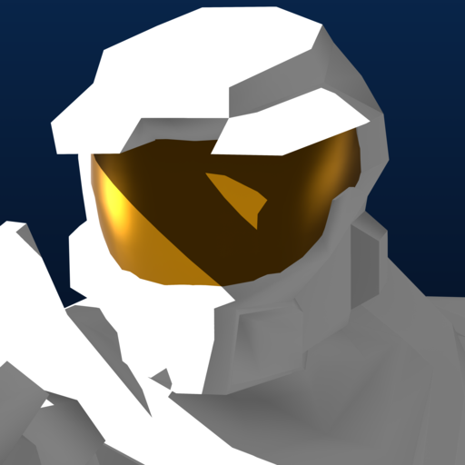

<div align="center">

# OpenCE : Forge

**Halo: Combat Evolved for Windows & Linux — Full [OpenCE](https://github.com/OpenCommunityEdition/OpenCE) Port with Integrated 3D Forge Mode**

<p align="center">
  
</p>

[](https://github.com/SutlabSol/HaloOpenCE-Forge/releases/latest)
[](https://github.com/OpenCommunityEdition/OpenCE)
[](LICENSE)

[**Download Latest Windows Release**](https://github.com/SutlabSol/HaloOpenCE-Forge/releases/latest) ·
[Overview](#overview--unified-opence-integration) ·
[Forge Menu & Tag Options](#forge-menu--tag-options) ·
[In-Game Forge Features](#in-game-forge-features) ·
[Installation](#installation) ·
[Controls](#controls-in-forge) ·
[Building from Source](#building-from-source)

</div>

---

## Overview — Unified OpenCE Integration

**OpenCE : Forge** is a fork and feature addition to [**OpenCE** (Open Community Edition)](https://github.com/OpenCommunityEdition/OpenCE), the native C port of the Halo: Combat Evolved Xbox decompilation (`01.01.14.2342`).

Rather than shipping as a separate standalone addon binary with stripped menus, **Forge Mode is now natively integrated directly into `halo.exe`** alongside the full Campaign, Standard Multiplayer, Co-Op, and Mods experience:

- **Full Campaign & Standard Multiplayer Intact:** Play solo or online Co-Op Campaign, browse the 128-player Internet/LAN Server Browser, play SWAT, Infection, Gun Game, or Hardcore, and use Mods from the main menu just like upstream OpenCE.
- **Unified `SELECT GAMEMODE` Multiplayer Hub:** Selecting **Multiplayer** on the main menu opens the **Select Gamemode** screen with two modes and live right-panel artwork/descriptions:
  - **STANDARD:** Normal OpenCE Multiplayer (Internet Server Browser, LAN, Split-Screen, Create Game).
  - **FORGE:** Opens the dedicated Forge Hub (**Solo Forge**, **Multiplayer Forge**, **Edit Maps**, and **Tag Options**).
- **Compressed `.ocetags` Cache (`OCEZ`) & 122 MB Map Support:** All extracted stock and custom tags are stored using `zlib` stream compression (`OCEZ`) with a deduplicated binary manifest (`manifest.bin`), minimizing disk footprint while supporting a **512 MB contiguous memory window** and **122 MB map/tag cache limit**.
- **Standalone `.map` Tag Injection & Baking (`v2.1.0`):** Maps forged and saved (`F5` or `Pause -> SAVE MAP..`) inject and bake all placed objects, spawns, objectives, and imported custom/campaign tags (from Faber Tag Vault `.fbrtag` / `faber_vault.bin`, decompressed Xbox donor caches, `.fxtg` bundles, and `.ocetags` packages) directly into a standalone Halo Custom Edition `.map` file in `custom_maps/` so forged maps play natively in Standard Mode Multiplayer without external tag files.

> [!IMPORTANT]
> **No proprietary game maps or copyrighted assets are included in this repository or its releases.** You must provide your own Halo: Combat Evolved `maps/` (or Xbox `.iso` / `.xiso` disc image) and optional Halo Custom Edition `custom_maps/` (`bitmaps.map`, `sounds.map`, `loc.map`). On first launch, `halo.exe` builds your local compressed tag cache in `OpenCE Forge/cached_tags/` directly from your own maps.

---

## Forge Menu & Tag Options

Navigating to **`MULTIPLAYER -> FORGE`** opens the Forge Hub:

1. **SOLO FORGE:** Choose any Multiplayer, Custom Multiplayer, or saved Forge map (`FORGE MAPS` tab) and load directly into an endless single-player Forge editing session.
2. **MULTIPLAYER FORGE:** Host an Internet, LAN, or Split-Screen collaborative Forge lobby where multiple players can toggle between **343 Guilty Spark Monitor** (`F1`) and **Spartan** in real time and build together.
3. **EDIT MAPS:** Browse **User Created** and **Downloaded** Forge maps with preview bitmaps and author metadata.
4. **TAG OPTIONS:** Complete in-menu tag extraction and cache management suite:
   - **`ADD TAGS`:**
     - Opens a Map Picker (`CUSTOM SINGLEPLAYER` / `CUSTOM MULTIPLAYER`) for browsing Custom Edition maps in `custom_maps/`.
     - Selecting any map opens the **Map Tag Browser** across 5 categories (`SCENERY`, `VEHICLES`, `DEVICES`, `WEAPONS`, `EQUIPMENT`).
     - Features a **live rotating 128×128 3D model preview** on the right-hand panel along with `- <tag name>`, `- <tag type>`, and `- <tag size>`.
     - Pressing **`CHOOSE`** prompts you to enter a custom Forge menu name (`[C] <your_name>`) in a dedicated input box, then extracts the tag and its full dependency closure into the Faber Tag Vault (`OpenCE Forge/tag_vault/`) and injects it into the Forge spawn menu.
   - **`INSTALLED TAGS`:**
     - Browse all tags currently installed in your cache across the same 5 categories (`SCENERY`, `VEHICLES`, `DEVICES`, `WEAPONS`, `EQUIPMENT`) with the live rotating 3D preview and size breakdown.
     - Choosing any tag opens a confirmation dialog allowing you to **delete** individual tags from the cache.
   - **`RESET STOCK TAGS`:**
     - Prompts an *"Are you sure?"* confirmation dialog (`CONFIRM` / `BACK`) to clear the stock tag cache completely while preserving your custom tags.
   - **`RESET CUSTOM TAGS`:**
     - Prompts an *"Are you sure?"* confirmation dialog (`CONFIRM` / `BACK`) to clear all custom `[C]` tags from the cache.

---

## In-Game Forge Features

- **3D Monitor Mode (`F1`):**
  - Seamless single-tick transition between Spartan and 343 Guilty Spark Monitor flying camera.
  - Grab, move, and place objects within **20m**; use the **Mouse Wheel** (or Gamepad triggers) to push/pull held objects between **1m and 30m**.
  - **3-Axis Rotation (`Hold R` + Mouse, `Q`/`E` to cycle Yaw / Pitch / Roll)** and **Rotation Snap (`G`)** (`Off -> 5° -> 15° -> 45° -> 90°`).
  - **Snap to Floor (`Hold Z`)** and **Snap to Surface Normal (`Hold F`)**.
- **Tabbed Object Palette (`F2`):**
  - Spawn **Vehicles**, **Weapons**, **Equipment**, **Scenery**, **Devices / Doors**, **Lighting & Emitters**, **Gametype Objectives & Spawns**, and **Custom `[C]` Tags** injected from any Campaign or Custom Edition map.
- **Visual Map Spawns & 3D Objective Markers:**
  - Existing map spawns and netgame flags (`Player Spawns`, `CTF Flags`, `Oddball Spawns`, `King of the Hill` with 3D boundary beams, `Race Track Points`, and `Teleporters` with working runtime pass-through collision) render as 3D translucent markers in Monitor Mode and can be moved, rotated, deleted, or configured via **`X` (Object Properties)**.
- **Collaborative Multiplayer Forge (`!FT:`, `!FS:`, `!FH:`, `!FM:`, `!FD:`, `!FQ`):**
  - Remote Monitors interpolate smoothly at 20 Hz, automatically eject seated vehicle passengers when grabbed, wake vehicle physics on placement, and fault in external/custom `.ocetags` definitions on the fly for all connected clients.

---

## Installation

### Option A: Full Windows Release (`OpenCE-Forge-Windows.zip`)
1. Download **`OpenCE-Forge-Windows.zip`** from the [Releases](https://github.com/SutlabSol/HaloOpenCE-Forge/releases/latest) page and extract it to a folder.
2. Copy your Halo Xbox `maps/` folder (or place your Halo Xbox `.iso` / `.xiso` disc image next to `halo.exe`) and optional Halo Custom Edition `custom_maps/` folder (`bitmaps.map`, `sounds.map`, `loc.map`, and custom `.map` files) into the directory.
3. Launch **`halo.exe`**.
4. On first launch, follow the prompt to select your Custom Edition and Retail/Xbox `maps` folders so Forge can build your compressed local tag cache in `OpenCE Forge/cached_tags/`.

### Option B: Updating an Existing OpenCE Folder
If you already have an OpenCE folder configured with `maps/`, `custom_maps/`, and `config.toml`, extract `halo.exe`, `SDL3.dll`, and the `OpenCE Forge/` folder from **`OpenCE-Forge-Windows.zip`** into your OpenCE directory and launch **`halo.exe`**.

---

## Controls in Forge

All Forge keyboard/mouse and controller bindings can be customized in-game under **`SETTINGS -> CONTROLS SETUP -> FORGE / FORGE PAD`**.

| Key / Input | Controller Default | Action |
| :--- | :--- | :--- |
| **`F1`** | **D-Pad Up** | Switch Play / Edit (3D Monitor) Mode |
| **`F2`** | **X** | Open / Close Inventory (Forge Object Palette) |
| **`X`** | **X** *(while holding item)* | Open Item Options (Team, Gametype, Snap, Save to Cache) |
| **`Left Click`** | **A** | Grab / Drop Item |
| **`Esc`** *(while holding item)* | **Hold B** | Cancel Grab / Drop Held Item |
| **`Delete` / `Backspace`** | **Y** | Delete Selected / Held Item |
| **`W` / `A` / `S` / `D`** | **Left Stick** | Move Monitor / Rotate Selected Item *(Pitch & Yaw with RT)* |
| **`Mouse Look`** | **Right Stick** | Look / Rotate Selected Item *(Roll with RT)* |
| **`Hold R` + Mouse** | **Hold Right Trigger (RT)** | Rotate Selected Item (`Q` / `E` cycles Yaw, Pitch, Roll on KB/M) |
| **`Space` / `Shift`** | **Right Bumper (RB) / Left Bumper (LB)** | Move Monitor Up / Move Monitor Down |
| **`C`** | **D-Pad Right** | Copy / Duplicate Hovered Object |
| **`F3`** | **Back** | Toggle 1st-Person / 3rd-Person View |
| **`F5`** | **D-Pad Down** | Quick Save Forge Map (`custom_maps/` & `OpenCE Forge/forge_maps/`) |
| **`G`** | **Left Thumb (LS)** | Cycle Rotation Snap (`Off`, `5°`, `15°`, `45°`, `90°`) |
| **`Hold Z`** | **D-Pad Left** | Live-snap held object to floor |
| **`Hold F`** | **Right Thumb (RS)** | Align held object to surface normal |

---

## Building from Source

### Prerequisites
- **Python 3.9+** and **[Ninja](https://ninja-build.org/)**
- **LLVM / Clang** (`clang`, `lld-link`, `llvm-rc`, `llvm-objcopy`) targeting `i686-pc-windows-msvc`
- **Visual Studio Build Tools / Windows SDK** (32-bit x86 MSVC CRT & Windows SDK libraries)

### Build Commands
```powershell
python configure.py --release
ninja windows
```
This compiles `build/windows/halo.exe` and `build/windows/SDL3.dll`. If you modify menu definitions in `tools/port_settings.py`, regenerate the embedded menu XML before building:
```powershell
python tools/port_settings.py
ninja windows
```

---

## Licence & Credits

- **OpenCE : Forge** is developed by **SutlabSol** on top of [OpenCommunityEdition/OpenCE](https://github.com/OpenCommunityEdition/OpenCE) ([bnunu/halo-1](https://github.com/bnunu/halo-1) / [punpckhdq/halo](https://github.com/punpckhdq/halo)).
- High-resolution HUD and menu art redraws are credited in [AUTHORS.md](AUTHORS.md).
- Licensed under the [GNU Affero General Public License v3.0 or later (`AGPL-3.0-or-later`)](LICENSE).
